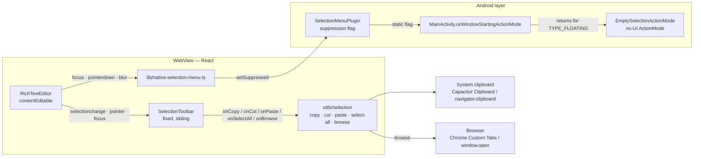
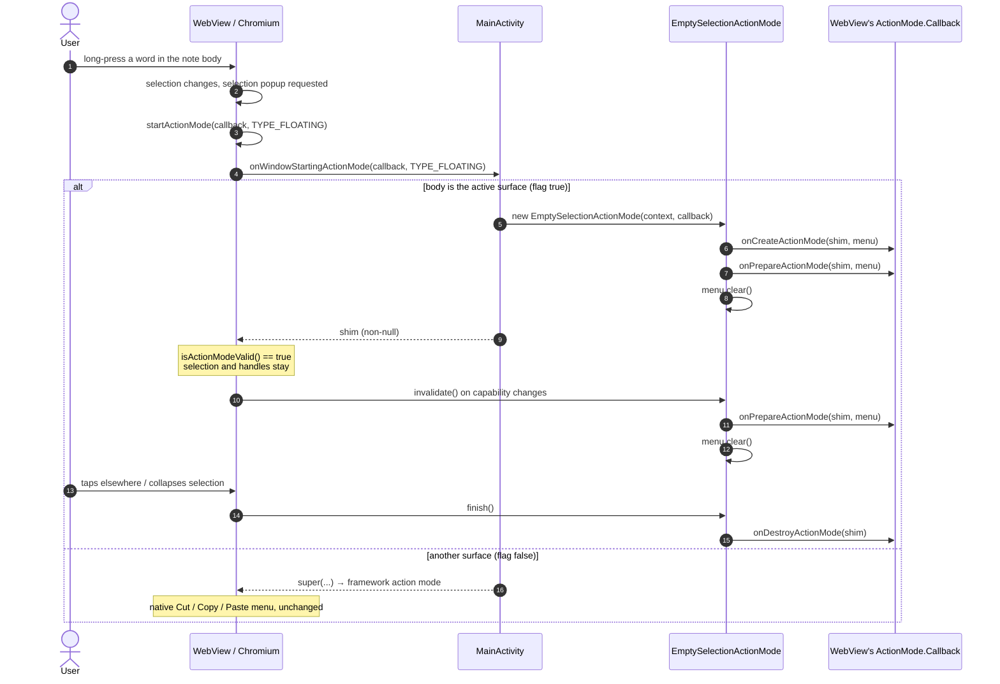
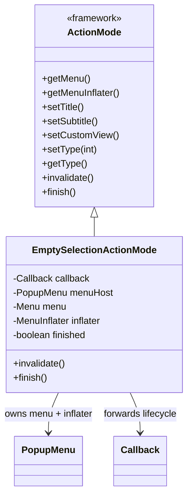
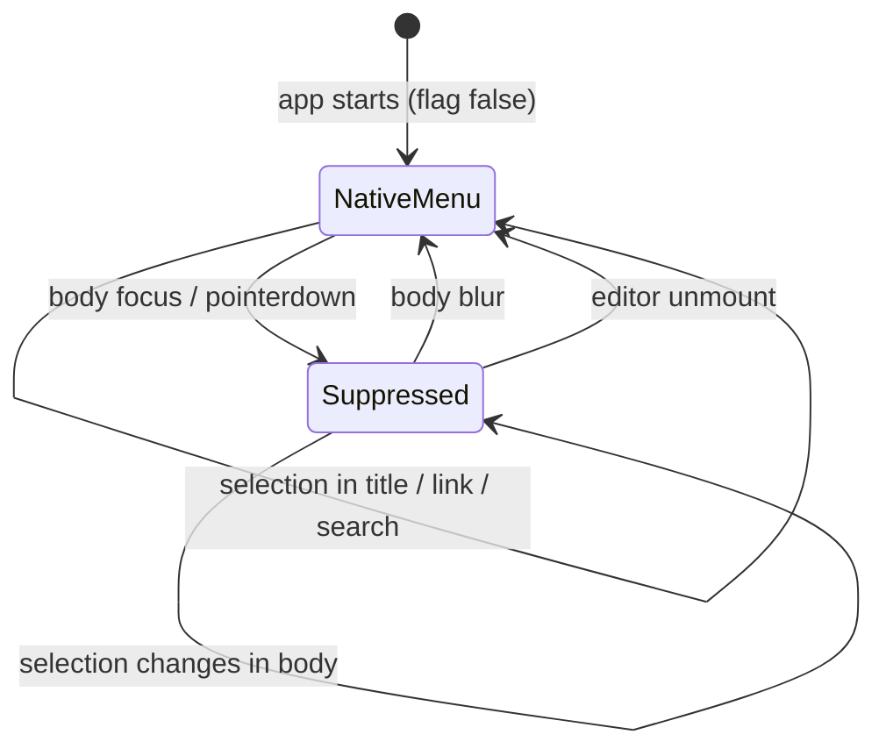
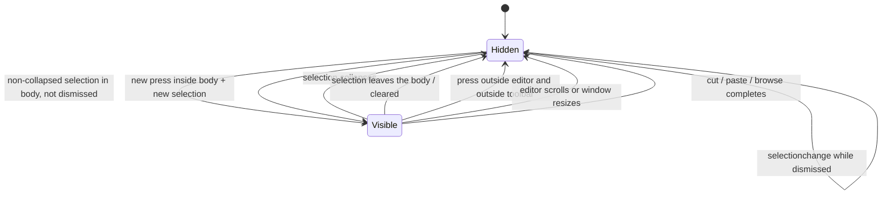
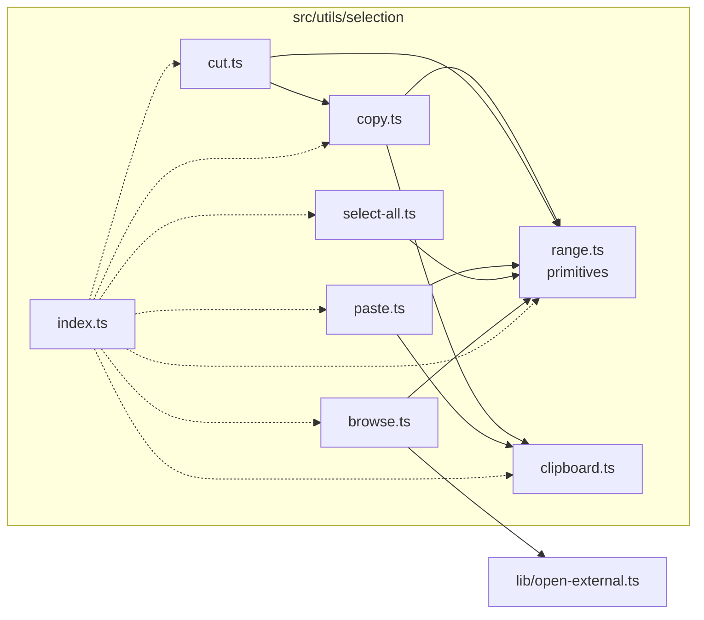

# Stash — text-selection toolbar

**Status:** implemented (web verified; Android build verified, device behaviour pending)
**Scope:** the note editor's `contentEditable` body
**Related files:** see [§12 File map](#12-file-map)

This document describes the design of Stash's custom text-selection toolbar and the
native Android layer that keeps the system's floating Cut / Copy / Paste menu out of
the note body. It records *why* each part exists, not only what it does, because the
native half is easy to break in ways that still compile.



---

## 1. The problem this replaces

Android draws Cut / Copy / Paste over a WebView text selection as a floating
`ActionMode`. Chromium owns the flow: in `SelectionPopupControllerImpl` it calls

```java
setActionMode(mView.startActionMode(mCallback, ActionMode.TYPE_FLOATING));
if (!isActionModeValid() && hasSelection()) clearSelection();
```

Two consequences drive the whole design:

1. **`null` is not "no menu".** Returning `null` from the Activity (or the WebView)
   means "the window should start the default action mode", so the native bubble
   survives. That was the previous implementation's failure.
2. **A `null` answer also loses the selection.** Chromium treats a null action mode
   as a failed selection and calls `clearSelection()`, which takes the selection and
   the handles with it. Killing the menu by refusing the mode is therefore not an
   option — the slot has to be *filled* with something that draws nothing.

The requirement is narrower than "hide all native menus": only the note body should
lose the system menu, because Stash has its own toolbar there. The title, the link
field and the search box are ordinary native inputs whose own paste menu is still
the right UI.

## 2. Design goals and non-goals

**Goals**

- No native floating menu over a body selection, on every supported Android version.
- Native selection is preserved: handles, dragging, caret placement, long-press word
  selection, Select-All gestures inside the editor.
- The replacement toolbar lives in React, outside the `contentEditable`, themed by
  the app's own light/dark tokens.
- Copy / Cut / Paste / Select All are real operations and feed the editor's normal
  Markdown + autosave pipeline.
- Android-specific mechanisms stay in the Android layer; editing logic stays in
  reusable TypeScript modules.

**Non-goals**

- Changing the app's ActionBar, theme, navigation or overall selection behaviour.
- Reflection into Android private framework classes (`FloatingToolbar`,
  `PhoneWindow`, `AwContents`) as the primary mechanism.
- Suppressing selection UI in every text field in the app.
- iOS callout suppression (see [§11 Limitations](#11-limitations-and-known-risks)).

## 3. Architecture overview

The system has four layers, each with one responsibility:

| Layer | Responsibility | Must not do |
| --- | --- | --- |
| Android `ActionMode` shim | Occupy the native selection slot without drawing | Know about notes or the web app |
| Capacitor plugin | Carry "body is active" as a boolean | Decide UI |
| Editor (`RichTextEditor`) | Track selection, position the toolbar, wire actions | Re-implement clipboard/editing primitives |
| Utilities (`utils/selection`) | Copy, cut, paste, select all, browse | Render or depend on the toolbar |

### 3.1 Native suppression sequence



The shim is returned *only* for `TYPE_FLOATING` while the flag is set.
`TYPE_PRIMARY` is delegated to the framework; the app has no ActionBar, and native
widgets outside the WebView keep their normal behaviour.

### 3.2 The shim's contract



Implementation notes:

- `PopupMenu(context, new View(context))` is used only to obtain a public `Menu`
  and `MenuInflater`; it is never shown.
- The constructor runs the WebView's `onCreateActionMode` and
  `onPrepareActionMode` once, so Chromium's helper records the mode and selected
  text exactly as it would with the native menu. The items are then cleared.
- `invalidate()` rebuilds the helper's model and clears the menu again.
- `finish()` is idempotent and calls the callback's `onDestroyActionMode`. Chromium
  calls `finish()`, then nulls its own reference, so this is the same teardown point
  the default implementation used.
- `getType()` returns `TYPE_FLOATING`, which makes Chromium's
  `isFloatingActionMode()` path take its "hide" branch against a no-op `hide()`.
- No hidden APIs and no reflection: `ActionMode`, `PopupMenu`, `Menu`,
  `MenuInflater` and `View` are all public.

## 4. Scoping the suppression



`SelectionMenuPlugin` holds a `static volatile boolean suppressed`. The web layer
calls `setSuppressed` through `src/lib/native-selection-menu.ts`, which:

- is a no-op when `Capacitor.isNativePlatform()` is false;
- deduplicates repeated values (`applied`), so focus and pointer events do not flood
  the bridge;
- forgets the cached value if the call rejects (an older APK without the plugin), so
  a later build still gets a chance.

The editor raises the flag on **focus** and **pointerdown** and lowers it on
**blur** and **unmount**. Pointerdown matters: a long-press starts there, well
before selection completes, which covers the first press after focus moved to
another surface. Scoping to the body (rather than to the editor screen mounting)
is what keeps the title's and link field's native paste menus working.

## 5. Selection model in the editor

The editor keeps its existing selection architecture; the toolbar reuses it.

| Ref | Purpose | Changed? |
| --- | --- | --- |
| `lastRange` | Last caret/selection inside the body; fallback when a tap collapses it | Reused, updated on every `selectionchange` and after cut/paste/select-all |
| `savedRange` | Range saved before a dialog/sheet opens (`saveSelection`) | Untouched |
| `armed` | Inline format armed at a collapsed caret | Untouched; reset when a selection is made or an action edits |
| `escaping` | Format the next character leaves | Untouched; same resets |
| `lastEmitted` | Markdown this editor last produced | Untouched |
| `onChangeRef` | Latest `onChange` callback | Untouched |

The toolbar is driven by **one** `selectionchange` listener for the surface. It
filters by `element.contains(selection.anchorNode)`, which means:

- a selection elsewhere on the page hides the toolbar rather than lighting it;
- a collapsed selection in the body hides it;
- a non-collapsed selection in the body positions and shows it.

No second listener and no second toolbar component exists.

## 6. Toolbar behaviour

### 6.1 Visibility state machine



The `dismissed` ref exists because losing focus does not always collapse the DOM
selection. Without it, an outside tap would hide the toolbar and the next
`selectionchange` would immediately show it again. A press inside the editor clears
the latch; a press anywhere else sets it.

### 6.2 Positioning

Position is computed by the editor, not the component:

```ts
const rect = selectionRect(range);        // first client rect
const center = rect.left + rect.width / 2;
const left = clamp(center, 8 + 88, innerWidth - 88 - 8);
const above = rect.top > 64;
// placement: 'above' → top = rect.top; 'below' → top = rect.bottom
```

The first client rect is deliberate: a multi-line selection's bounding box is the
column width, whose centre is the paragraph's, not the words'. Placement switches
below the selection when there is not enough room above. The horizontal clamp keeps
the toolbar on a narrow screen at either margin.

The CSS turns `left`/`top` into the final position with `translate(-50%, …)` for
above/below, so the component never needs to know its own height.

### 6.3 Surface and theme

`.selection-toolbar` is a `position: fixed` card using only design tokens:

- `--surface` at 95% with backdrop blur, `--border`, `--radius-control`;
- `--elevation-raised`, `--fg` and `--surface-2` for the pressed state;
- `--animate-pop-in`, which already collapses under `prefers-reduced-motion`.

Because every colour is a token, the toolbar follows the app's own light/dark
resolution rather than the device's night mode — the specific mismatch that made
Android's native menu a black slab over a light note.

### 6.4 Interaction safety

- The toolbar is a **sibling** of the `contentEditable`, never a child.
- `onMouseDown` is prevented on the toolbar and each button, so pressing it does not
  blur the editable or collapse the selection on desktop.
- On Android a tap can still move focus; every action resolves the range as
  `live selection ?? lastRange`, and validates that the remembered range is still
  connected and inside the editor.
- `role="toolbar"` with `aria-label="Text selection"`; buttons are labelled
  ("Copy", "Cut", "Paste", "Select all", "Search on Google") and keep the app's
  existing 2rem control height.

## 7. Utilities



| Module | Public API | Behaviour |
| --- | --- | --- |
| `range.ts` | `isRangeInsideEditor`, `liveSelectionRange`, `resolveSelectionRange`, `rangeText`, `selectionRect`, `restoreSelectionRange`, `deleteRangeContents` | DOM-only primitives; every one refuses to act outside the editor |
| `clipboard.ts` | `writeClipboardText`, `readClipboardText`, `usesNativeClipboard` | Capacitor Clipboard on Android; async Clipboard API on web; legacy textarea copy as fallback; read returns `null` when unavailable |
| `copy.ts` | `copySelection` | Resolves range, captures text **before** awaiting the clipboard, returns `{copied, text, range}` |
| `cut.ts` | `cutSelection` | Copies first; deletes only if the copy succeeded; returns the collapsed caret |
| `paste.ts` | `pasteSelection` | Reads clipboard, restores the range, inserts escaped **text** with the editor's editing command; returns `{pasted, text, readable}` |
| `select-all.ts` | `selectAllInEditor` | `range.selectNodeContents(host)` — the note body only |
| `browse.ts` | `browseSelection`, `googleSearchUrl` | Opens a Google search for the trimmed selection; Custom Tabs on Android, synchronous `window.open` on web |
| `index.ts` | barrel | Single import surface for other consumers |

### 7.1 Action flows

```mermaid
sequenceDiagram
    autonumber
    actor User
    participant Bar as SelectionToolbar
    participant Ed as RichTextEditor
    participant U as utils/selection
    participant Sys as Clipboard / Browser

    User->>Bar: press Copy
    Bar->>Ed: onCopy()
    Ed->>U: copySelection(host, lastRange)
    U->>U: resolve range, read text
    U->>Sys: write text
    Sys-->>U: ok / failed
    U-->>Ed: {copied, text, range}

    User->>Bar: press Cut
    Bar->>Ed: onCut()
    Ed->>U: cutSelection(host, lastRange)
    U->>Sys: write text (copy first)
    Sys-->>U: ok
    U->>U: deleteRangeContents(range)
    U-->>Ed: {cut: true, caret}
    Ed->>Ed: hideToolbar(); emit(); publishFormats()

    User->>Bar: press Paste
    Bar->>Ed: onPaste()
    Ed->>U: pasteSelection(host, lastRange)
    U->>Sys: read clipboard
    Sys-->>U: text
    U->>U: restore range, insert text
    U-->>Ed: {pasted: true}
    Ed->>Ed: hideToolbar(); emit(); publishFormats()

    User->>Bar: press Select all / Search on Google
    Bar->>Ed: onSelectAll() / onBrowse()
    Ed->>U: selectAllInEditor(host) / browseSelection(host, lastRange)
    U-->>Ed: range / opened
```

`emit()` is the editor's existing serialisation step (`htmlToMarkdown` + `onChange`),
so autosave sees a cut or paste as the same kind of change as a keystroke. Paste
additionally triggers the engine's normal `input` event, which is harmless: the
editor compares Markdown before adopting a change and the parent compares drafts.

### 7.2 Why these primitives

- **Cut copies before it deletes.** A clipboard refusal on a platform that cannot
  report it must not consume the user's words. A failed copy returns `{cut: false}`
  with the document untouched.
- **Cut deletes by range, not by command.** Range surgery preserves the surrounding
  formatting and block structure; the serialiser already knows how to write the
  result. The returned caret goes back into `lastRange`.
- **Paste inserts text, not HTML.** Reading the clipboard as text and inserting it as
  escaped text means a copied web page cannot smuggle markup or scripts into a note.
  `insertText` is the same editing-command family the editor already uses for
  `insertHTML` and formatting; using it here gets block splitting and a correct final
  caret without a second DOM surgery implementation.
- **Select All is scoped by construction.** `selectNodeContents(host)` cannot select
  the title, the status line or the toolbar.
- **Browse is synchronous on the web.** `window.open` after an `await` loses the user
  gesture and is blocked; on Android the await goes to Custom Tabs, which is not
  gesture-gated.

## 8. Preserving the editor's architecture

The change is additive around the existing systems, not a rewrite:

| System | How it is preserved |
| --- | --- |
| Uncontrolled `contentEditable` | The toolbar re-renders but never rewrites the editable node. Actions mutate the DOM directly at the live/remembered range. |
| Markdown storage | Every mutating action calls `emit()`, which runs the same `htmlToMarkdown` serialisation as typing. |
| Autosave | `onChange` → `NoteEditor` draft → `useAutosave`; unchanged. |
| Formatting commands | `runEditorCommand`, `armed`, `escaping` and `publishFormats` are untouched; toolbar actions reset the pending-format refs where an edit makes them stale. |
| `lastRange` / `savedRange` | Reused; select-all and cut update `lastRange`, paste re-reads it after insertion. |
| Focus/caret handling | `restoreSelectionRange` focuses with `preventScroll` and then applies the range, matching the editor's existing ordering. |

Verified behaviour on the web build: bold applies, survives a reload, and renders
from stored Markdown (`**quick**` → `<strong>quick</strong>`); autosave reports
"Saved" after typed, cut, pasted and formatted changes.

## 9. Accessibility

- `role="toolbar"`, `aria-label="Text selection"`; each button has `aria-label` and
  `title`, so the icon-only layout is still announced.
- Buttons are real `<button type="button">` elements and keyboard reachable; the
  `mousedown` guard only prevents focus on pointer press, it does not disable the
  button.
- No focus trapping, no live region: the toolbar is transient and its actions are
  announced by their effects (clipboard, selection, navigation).
- Themes use tokens with the same contrast roles as the rest of the app.

## 10. Platform matrix

| Behaviour | Android (native shell) | Web |
| --- | --- | --- |
| Native floating menu | Suppressed over the body via `EmptySelectionActionMode` | Browser controls; none in the app's scope |
| Copy | `@capacitor/clipboard` `write` | `navigator.clipboard.writeText`, legacy fallback |
| Paste | `@capacitor/clipboard` `read` | `navigator.clipboard.readText` (permission-gated) |
| Browse | Chrome Custom Tabs (`Browser.open`) | `window.open` in the click gesture |
| Selection handles / dragging | WebView-owned, untouched | Browser-owned |
| Title / link / search menus | Native, unchanged (suppression only while the body is active) | Browser-native |

## 11. Limitations and known risks

1. **No device verification in this environment.** The Android code compiles
   (`assembleDebug` succeeds) and follows Chromium's public contract, but the
   suppression, handle persistence and cross-app paste were not observed on a phone
   or emulator.
2. **The shim depends on Chromium's contract**, not on a formal API guarantee: it
   assumes the returned `ActionMode` is stored and its callback is the WebView's.
   This is the same surface every WebView selection menu uses, and it avoids private
   APIs; a future WebView change would be visible as the native menu returning.
3. **Scoping is focus-based.** If the body is focused but a selection is made in
   another editable surface on the same screen without a blur event (not currently
   possible in the note editor layout), that surface would also lose its native menu
   until blur.
4. **Toolbar hides on scroll.** A floating menu over moving content would point at
   the wrong words; the trade-off is that scrolling during a selection dismisses it
   until the selection changes.
5. **The horizontal clamp uses an estimated half-width (88 px).** The rendered width
   is ~167 px at the current sizes; on an unusually narrow viewport the estimate is
   guarded rather than measured.
6. **iOS is out of scope.** The React toolbar still renders there, but WebKit's
   system callout is not suppressed by this change.
7. **Web clipboard reads require permission.** Paste reports "nothing happened"
   rather than pretending; there is no hidden paste field.
8. **Browsers may still block the Google popup** in unusual embedding contexts, even
   though the call is synchronous; on Android the Custom Tab path is unaffected.

## 12. File map

| Path | Role |
| --- | --- |
| `android/app/src/main/java/app/web/Stash/MainActivity.java` | Registers plugins; answers floating action modes with the shim while the body is active |
| `android/app/src/main/java/app/web/Stash/EmptySelectionActionMode.java` | No-UI `ActionMode` that keeps the selection and draws nothing |
| `android/app/src/main/java/app/web/Stash/SelectionMenuPlugin.java` | Capacitor plugin carrying the suppression flag |
| `src/lib/native-selection-menu.ts` | Web bridge for the flag; native-only, deduplicated, failure-tolerant |
| `src/components/notes/rich-text-editor.tsx` | Single selection listener, toolbar positioning/dismissal, action wiring |
| `src/components/selectionToolBar/selectionToolBar.tsx` | The toolbar component and its props |
| `src/components/selectionToolBar/selectionToolBar.css` | Token-based surface, placement transforms, button states |
| `src/components/ui/icons.tsx` | Added `Scissors`, `ClipboardText`, `SelectionAll` |
| `src/utils/selection/clipboard.ts` | System clipboard abstraction |
| `src/utils/selection/range.ts` | Editor-scoped range primitives |
| `src/utils/selection/copy.ts` | Copy action |
| `src/utils/selection/cut.ts` | Cut action |
| `src/utils/selection/paste.ts` | Paste action |
| `src/utils/selection/select-all.ts` | Select all within the body |
| `src/utils/selection/browse.ts` | Google search for the selection |
| `src/utils/selection/index.ts` | Barrel exports |

---

*This document describes behaviour observed in the running web build and the Android
debug build. Items that require a device are listed explicitly in §11.*
