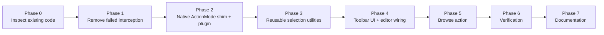
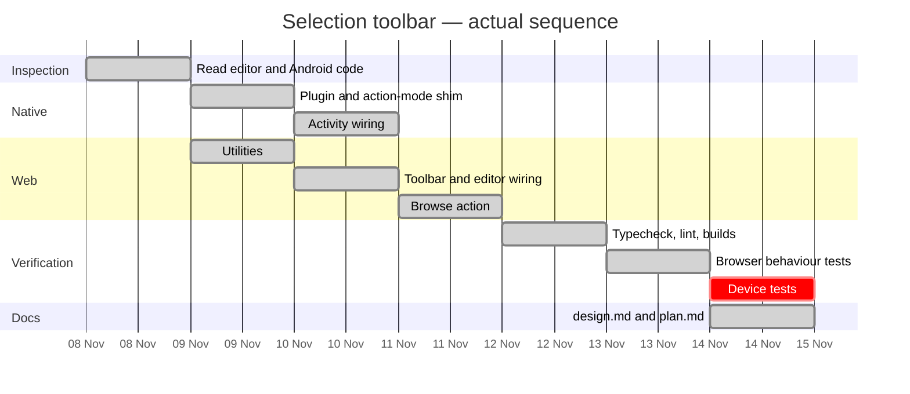
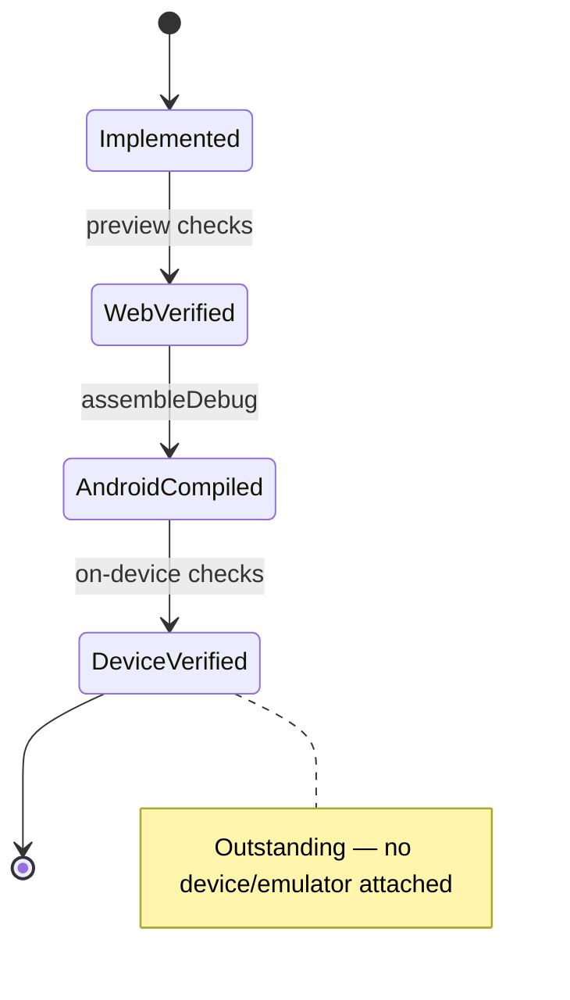

# Stash — text-selection toolbar: implementation plan

**Status:** implemented; web verified; Android compiled; device checks outstanding
**Companion document:** [`design.md`](./design.md)

This is the plan the implementation followed, kept up to date with what actually
shipped. Each phase lists its intent, the files it touched, and its verification
state. Unfinished or unverifiable items are named rather than assumed.



---

## 1. Objective

Replace Android's floating Cut / Copy / Paste menu over the note body with a Stash
selection toolbar, without losing native selection, handles or dragging, and without
breaking the editor's Markdown storage, formatting state or autosave.

**Success criteria**

1. No system selection menu appears over a body selection on Android.
2. Handles, long-press selection, dragging and caret placement still work.
3. A compact, themed React toolbar appears near the selection and dismisses cleanly.
4. Copy, Cut, Paste and Select All perform real operations.
5. Cut/paste flow through the existing Markdown + autosave pipeline.
6. Web clipboard actions work on desktop.
7. Reusable, UI-independent utilities live in `src/utils/selection/`.

**Non-goals**

- Changing the ActionBar, theme, navigation or global selection behaviour.
- Using reflection into Android private framework classes as the mechanism.
- Rewriting the editor or replacing `execCommand`-based formatting.

## 2. Constraints carried into the design

| Constraint | Consequence |
| --- | --- |
| Chromium clears the selection when `startActionMode` returns null | The native slot must be filled, not refused |
| `TYPE_FLOATING` is the WebView selection menu | Only that type is intercepted |
| The title, link field and search box need native menus | Suppression is scoped to body focus/pointer, not app-wide |
| Editor is uncontrolled; DOM leads while typing | The toolbar never rewrites the editable node |
| Storage format is Markdown | Every mutating action ends in `emit()` |
| `execCommand` already underpins insertion/formatting | Paste uses `insertText`; not a new architecture |
| No device attached | Native behaviour can only be compiled and reasoned about |

## 3. Task breakdown

### Phase 0 — Inspect the existing implementation

| Task | Result |
| --- | --- |
| Read `MainActivity.java` and the Android theme | Found experimental `onWindowStartingActionMode` returning `null` for `TYPE_FLOATING`, plus diagnostic logging |
| Read `rich-text-editor.tsx` | Found a single `selectionchange` listener, `lastRange`, `armed`, `escaping`, `savedRange`, `emit()` |
| Read `SelectionToolbar` | Placeholder component: Copy/Cut/Paste labels, no handlers, position from the editor |
| Inspect `_selection_popup_dump.java` (`SelectionPopupControllerImpl`) | Confirmed the null-answer contract and the `setActionMode(mView.startActionMode(...))` call |
| Check dependencies | `@capacitor/clipboard` already installed; no new package needed |

### Phase 1 — Remove obsolete interception

| Task | File | Status |
| --- | --- | --- |
| Delete reflection imports and duplicate imports | `MainActivity.java` | Done |
| Delete diagnostic `Log.d` action-mode override | `MainActivity.java` | Done |
| Keep theme-first `onCreate`, Edge-to-edge and plugin registration intact | `MainActivity.java` | Done |

### Phase 2 — Native suppression

| Task | File | Status |
| --- | --- | --- |
| Add suppression flag + Capacitor method | `SelectionMenuPlugin.java` | Done |
| Implement no-UI `ActionMode` (`onCreate`/`onPrepare`/`invalidate`/`finish`) | `EmptySelectionActionMode.java` | Done |
| Return the shim for `TYPE_FLOATING` when the flag is set | `MainActivity.java` | Done |
| Register the plugin with Capacitor | `MainActivity.java` | Done |
| Web bridge with native-only, deduplicated, failure-tolerant calls | `src/lib/native-selection-menu.ts` | Done |
| Raise on body focus/pointerdown, lower on blur/unmount | `rich-text-editor.tsx` | Done |

### Phase 3 — Utilities

| Task | File | Status |
| --- | --- | --- |
| Editor-scoped range primitives | `range.ts` | Done |
| Clipboard abstraction (native/web/fallback) | `clipboard.ts` | Done |
| Copy | `copy.ts` | Done |
| Cut (copy first, delete second) | `cut.ts` | Done |
| Paste (clipboard text at caret/selection) | `paste.ts` | Done |
| Select All (body only) | `select-all.ts` | Done |
| Barrel exports | `index.ts` | Done |

### Phase 4 — Toolbar and wiring

| Task | File | Status |
| --- | --- | --- |
| Props for Copy/Cut/Paste/Select All; token-based surface | `selectionToolBar.tsx`, `.css` | Done |
| Icons for Cut / Paste / Select All | `ui/icons.tsx` | Done |
| Position near selection, clamp to viewport, above/below | `rich-text-editor.tsx` | Done |
| Hide on collapse, outside press, scroll, resize, after edit | `rich-text-editor.tsx` | Done |
| Dismissed latch so outside taps are not undone by `selectionchange` | `rich-text-editor.tsx` | Done |
| Real action handlers feeding `emit()` and `publishFormats()` | `rich-text-editor.tsx` | Done |
| Remove stray `console.log` diagnostics | `rich-text-editor.tsx` | Done |

### Phase 5 — Browse action

| Task | File | Status |
| --- | --- | --- |
| Google URL builder + platform-aware opener | `browse.ts` | Done |
| Toolbar button + `onBrowse` prop | `selectionToolBar.tsx` | Done |
| Handler wired to the editor and dismisses after opening | `rich-text-editor.tsx` | Done |

### Phase 6 — Verification

See [§6 Verification](#6-verification).

### Phase 7 — Documentation

| Task | File | Status |
| --- | --- | --- |
| Design/architecture documentation | `docs/selection-toolbar/design.md` | Done |
| This plan, decisions, risks and results | `docs/selection-toolbar/plan.md` | Done |

## 4. Key decisions

| Decision | Chosen because | Rejected alternative |
| --- | --- | --- |
| Return a no-UI `ActionMode` | Fills Chromium's slot, keeps selection and handles, public APIs only | Returning `null` (native menu remains, selection cleared); reflection into `FloatingToolbar`/`PhoneWindow`; replacing the WebView class (not injectable through Capacitor) |
| Intercept in `MainActivity.onWindowStartingActionMode` | The activity is the window callback; the WebView's selection mode passes through it | `WebView.startActionMode` override (needs a custom WebView Capacitor cannot supply) |
| Scope with a JS-driven flag | Only the body loses the native menu; title/link/search keep theirs | Suppress all `TYPE_FLOATING` app-wide (breaks native paste in inputs) |
| Flag on focus **and** pointerdown | Pointerdown precedes a long-press, closing the first-selection race | Focus only (race on first long-press); editor mount (would also suppress the title and link field) |
| Range surgery for cut; `insertText` for paste | Cut preserves formatting structure; paste gets block splitting and a correct caret from the mechanism the editor already uses | `execCommand('cut')` (clipboard control unclear on Android); HTML paste (markup injection) |
| Single `selectionchange` listener reused | No duplicate listeners/components; existing `lastRange`, `armed`, `escaping` stay authoritative | A second listener or a portal-mounted toolbar |
| `dismissed` latch on outside press | Focus loss does not always collapse the DOM selection | Relying on `selectionchange` alone (toolbar reappears) |
| Sync `window.open` on web, Custom Tabs on Android | Preserves the user gesture for popup policies; keeps Stash alive natively | Awaiting an import before `window.open` (blocked popup) |
| Token-only toolbar styling | Follows the app's light/dark choice, not the device's | Native `ActionMode` theming (the original mismatch) |

## 5. Execution map





## 6. Verification

### 6.1 Commands run

| Command | Result |
| --- | --- |
| `npx tsc --noEmit` | Clean |
| `npx eslint src/components/notes/rich-text-editor.tsx src/components/selectionToolBar src/utils/selection src/lib/native-selection-menu.ts` | Clean |
| `npx eslint .` | 5 errors, all pre-existing unused imports in `src/app/page.tsx` (file untouched) |
| `npm run build` | Success; all routes static |
| `npm run android:apk` (`assembleDebug`) | Success |
| `npm test` | 31/34 files pass; 3 failing files are unrelated (crypto/sync/privacy timing) and none import the changed modules |

### 6.2 Browser checks (desktop web, running dev server)

| # | Check | Result |
| --- | --- | --- |
| 1 | Toolbar renders on a body selection | Pass |
| 2 | Toolbar is a sibling, not inside `contentEditable` | Pass (`host.contains(bar) === false`) |
| 3 | Positioned above the selection, centred, on screen | Pass (bar ~42 px above the line; clamped) |
| 4 | Light and dark token colours | Pass (white/ink vs. dark surface/light ink) |
| 5 | Copy writes the real clipboard and keeps the selection | Pass (`navigator.clipboard.readText()` → `quick`) |
| 6 | Cut copies and removes the text | Pass (`brown ` removed, clipboard write succeeded first) |
| 7 | Paste replaces the selection at the caret | Pass (`dog` → ` PASTED`, using a stubbed `readText`; see limitation) |
| 8 | Select All selects only the body | Pass (range `commonAncestorContainer` is the body; title not selected) |
| 9 | Formatting still works after the change | Pass (Bold applied, `aria-pressed` updated) |
| 10 | Markdown persistence + autosave | Pass (reload renders `<strong>quick</strong>` from stored Markdown) |
| 11 | Toolbar hides on collapse | Pass |
| 12 | Toolbar hides on outside tap and stays hidden | Pass (dismissed latch) |
| 13 | Toolbar returns for a new body selection | Pass |
| 14 | Browse opens `google.com/search?q=<selection>` and dismisses | Pass (`?q=quick` captured) |

### 6.3 Device checks still required

| # | Check | Status |
| --- | --- | --- |
| 1 | Native floating menu never appears over a body selection | **Not run** |
| 2 | Selection handles remain visible and draggable | **Not run** |
| 3 | Long-press word selection and dragging still work | **Not run** |
| 4 | Copy pastes into another Android app | **Not run** |
| 5 | Cut deletes and copies; paste inserts from another app | **Not run** |
| 6 | Title, link field and search box keep their native menus | **Not run** |
| 7 | Toolbar position above/below the selection with the soft keyboard open | **Not run** |

## 7. Risk register

| Risk | Impact | Mitigation | Status |
| --- | --- | --- | --- |
| Chromium changes what it accepts from `startActionMode` | Native menu returns or handles vanish | Public-contract implementation; one place to adjust; documented | Accepted |
| Suppression leaks to other inputs | Users lose native paste in title/search | Flag scoped to body focus/pointer; blur and unmount clear it | Mitigated |
| Selection lost when a toolbar button takes focus | Copy/cut/paste act on nothing | `mousedown` prevention plus `live ?? lastRange` resolution | Mitigated |
| Clipboard write fails | Cut could delete without copying | Cut aborts unless the copy succeeded | Mitigated |
| Clipboard read denied on web | Paste silently does nothing | `readable: false` is returned; no fake read or empty insert | Accepted |
| Popup blocked for Browse on web | Button appears inert | Synchronous `window.open` inside the click gesture | Mitigated |
| Stale remembered range | Insertion at the start of the note | Range validated for connection and containment | Mitigated |
| Toolbar overlaps content permanently | Blocks taps above selection | Hidden on scroll/resize/outside press; small fixed card | Accepted |
| No device verification | Native behaviour unproven | Explicit limitation; compile + contract reasoning; manual checklist | Open |
| iOS system callout | Native callout still appears on iOS | Out of scope; React toolbar still renders | Accepted |

## 8. Regression checklist

Before shipping a build that touches this area:

- [ ] Long-press a word in a note body: no system menu, Stash toolbar appears.
- [ ] Drag both selection handles: selection updates, toolbar follows or hides.
- [ ] Tap elsewhere: toolbar disappears and does not reappear until a new selection.
- [ ] Copy, switch to Messages/Chrome, paste: text arrives.
- [ ] Cut: text leaves the note, is on the clipboard, note still saves.
- [ ] Paste from another app at a caret and over a selection.
- [ ] Select All: only the body is selected; typing replaces only the body.
- [ ] Apply Bold/Heading/list around a selection, reload: formatting persists.
- [ ] Search input and title still show their own native copy/paste menus.
- [ ] Rotate/background/restore with a note open: no stale toolbar, no stuck flag.

## 9. Open follow-ups

- Device verification (above), including a WebView version matrix if possible.
- iOS callout handling, if the toolbar is meant to replace it there too.
- Search-engine preference for Browse (currently always Google).
- Optional: measure the toolbar width instead of the 88 px half-width estimate.
- Optional: expose the utilities through keyboard shortcuts (the modules are
  UI-independent by design).

## 10. Commands reference

```bash
# web
npx tsc --noEmit
npx eslint .
npm run build

# android debug APK
npm run android:apk

# tests
npm test
```
